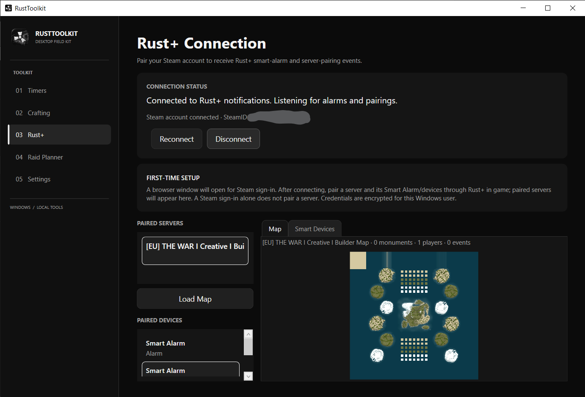
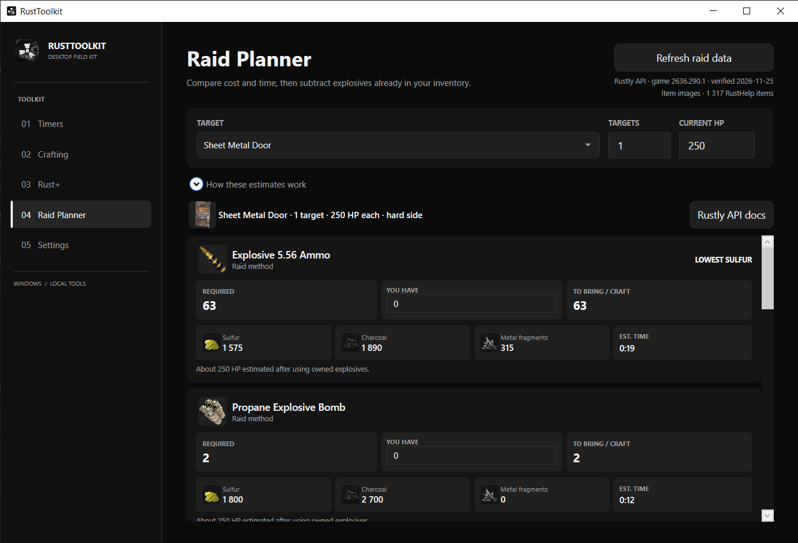

<div align="center">

# RUSTTOOLKIT

### A focused desktop companion for Rust.

Crafting plans, Rust+ alerts, server maps, timers, and practical Windows controls — in one native app.

[**Explore the website**](https://dekerit.github.io/RustToolkit/) ·
[**Download the latest release**](https://github.com/dekerIT/RustToolkit/releases/latest) ·
[View source](https://github.com/dekerIT/RustToolkit)

<br>

[](#download)
[](#build-from-source)
[](https://github.com/dekerIT/RustToolkit/releases/latest)

</div>

---

RustToolkit is an independent Windows application for players who want useful Rust tools close at hand. Local features work without Steam sign-in; connect to Rust+ only for live notifications, paired servers, maps, and devices.

## At a glance

| Local tools — no account needed | Rust+ tools — sign in and pair in-game |
| --- | --- |
| Rust item search, crafting calculator, and raid planner | Smart Alarm notifications and full-screen alerts |
| Saved countdown timers, item favorites, and Rust Notes graph view | Paired server map and markers |
| Windows startup and keep-awake option | Smart-device status and Smart Switch controls |

<p align="center">
  
  
</p>
<p align="center">
  
  
</p>
<p align="center">
  
</p>

## Download

Download the Windows installer from the [latest GitHub release](https://github.com/dekerIT/RustToolkit/releases/latest):

- **Installer — `RustToolkit-Setup-vX.Y.Z.exe`:** per-user setup, Start Menu shortcut, optional desktop shortcut, and uninstall support.

## Get started

1. Install RustToolkit and launch it.
2. Choose **I'll sign in later — continue** to explore the local tools, or connect Steam / Rust+.
3. For Rust+ features, sign in and pair a server and its Smart Alarm or smart devices in Rust+ in-game.
4. Open **Rust+** in the app and select a paired server. Load the map or request a device's current state.

Steam sign-in alone does not pair a server. Disconnect from the **Rust+** page to remove the locally saved account and pairing data.

## What it does

- **Crafting & item search:** search RustHelp's item catalog for images, recipes, research costs, and listed loot-source names. Choose an amount to see craft batches, nested ingredients, workbench requirements, base-material totals, and favorites.
- **Raid Planner:** compare Rustly's explosive methods by estimated sulfur cost and time. Set the target count, current HP, hard/soft side, and owned explosives to estimate what remains to bring or craft.
- **Raid Alarm:** real Smart Alarm events can play a looping siren and show a full-screen alert on connected monitors. **Test siren** only tests the local sound; press **F8** to stop an alert.
- **Timers:** named countdowns persist across app restarts and notify at 10 minutes, 3 minutes, and completion.
- **Notes:** the installer bundles the redesigned Rust Notes app with graph views inspired by Obsidian. Notes launches automatically with RustToolkit and is also available from the Start Menu.
- **Desktop controls:** minimize to the system tray, optionally start with Windows, and optionally prevent Windows from sleeping while the app runs.
- **Rust+:** connect or disconnect Steam, receive pairing and alarm notifications, view a paired map, read smart-device states, and manually control paired Smart Switches.

## Build from source

Requirements: Windows and the **.NET 10 SDK**. From the repository root, run:

```powershell
dotnet run --project .\csharp\RustToolkit.Desktop\RustToolkit.Desktop.csproj
```

Build the solution:

```powershell
dotnet build .\csharp\RustToolkit.sln
```

See [`csharp/README.md`](./csharp/README.md) for development notes.

## Data, privacy, and limitations

- Crafting item, recipe, research, loot-source, and image data are read from [RustHelp](https://rusthelp.com/) in an embedded WebView2 browser; the catalog is cached under `%LOCALAPPDATA%\RustToolkit\rusthelp`. The WebView2 Runtime is required for live RustHelp data.
- Raid costs and estimates continue to come from the [Rustly API](https://rustly.com/developers/api/).
- Custom-HP raid results are estimates: Rustly provides full-health explosive counts but not per-hit damage, so linear scaling cannot model overkill or random damage. Costs are game-material costs, not market prices.
- Maps and device states refresh when requested. Automatic smart-device routines are not currently available.
- Rust+ credentials are protected for the current Windows user with DPAPI. App settings, timers, and cached item data are stored locally under `%LOCALAPPDATA%\RustToolkit`.
- Rust+ pairing depends on Steam, Facepunch, and the third-party RustPlusApi package; their services and APIs may change.

## License

RustToolkit's original code and assets are proprietary. The repository's [`LICENSE`](./LICENSE) describes the limited permissions for viewing the source and using unmodified releases. Third-party dependencies retain their own licenses; see [`csharp/THIRD-PARTY-NOTICES.md`](./csharp/THIRD-PARTY-NOTICES.md).

## Roadmap

- [ ] Validate Steam sign-in, disconnect, Smart Alarm notifications, pairing, map loading, and device controls with a real Rust+ account and server.
- [ ] Improve Rust+ reconnect behavior and map-marker controls.
- [ ] Add optional smart-device automations and clearer first-use pairing guidance.
- [ ] Validate RustHelp crafting and loot data and Rustly raid data against in-game values.

---

RustToolkit is an independent fan-made project and is not affiliated with or endorsed by Facepunch Studios. Rust and related names are trademarks or properties of their respective owners.
