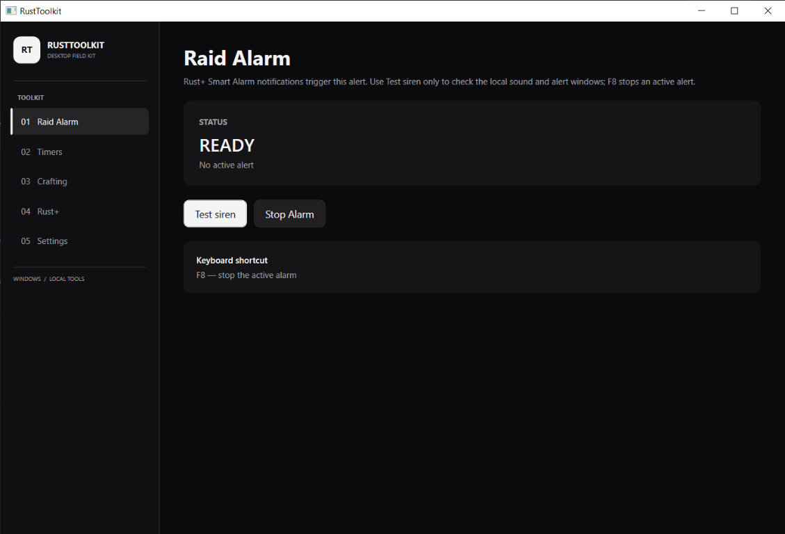

<div align="center">

# RustToolkit

**Windows desktop companion app for Rust, built with WPF and .NET 10.**

[](#quick-start)
[](#quick-start)
[](#roadmap)

</div>

RustToolkit is an independent fan-made Rust companion. The current application is the C# desktop app in [`csharp/`](./csharp/). Rust+ sign-in and pairing use Steam and Facepunch services; saved Rust+ credentials are encrypted for the current Windows user with DPAPI.

## Interface

<p align="center">
  
  
</p>
<p align="center">
  
  
</p>

## Features

- **Raid alarm:** looping siren and full-screen alert; acknowledge with F8, the alert, or the tray.
- **Timers:** named countdowns saved locally and restored after restarting.
- **System tray:** keep RustToolkit running in the background; optionally start with Windows.
- **Rust+:** Steam pairing, Rust+ smart-alarm notifications, and server/device pairing events.
- **Server map:** load a paired server's map on demand with monuments, players, and event markers.
- **Smart devices:** read smart-device and storage-monitor state; manually set paired Smart Switches.
- **Local data:** Rust+ profile and pairing credentials are protected using Windows DPAPI for the current user.

Rust+ map and device data refresh only when requested. Device automation, continuous map updates, and the raid calculator are not implemented yet.

## Quick start

Install the **.NET 10 SDK**, open PowerShell in the repository folder, and run:

```powershell
dotnet run --project .\csharp\RustToolkit.Desktop\RustToolkit.Desktop.csproj
```

Build the solution with:

```powershell
dotnet build .\csharp\RustToolkit.sln
```

To pair Rust+, open the **Rust+** page, select **Connect Rust+**, complete Steam sign-in, and pair the server/devices in Rust. Select a saved server and choose **Load Map** to display its map.

## Roadmap

### Done

- [x] Create the WPF/.NET 10 desktop application shell.
- [x] Implement the local alarm, F8 acknowledgement, multi-monitor alert, and tray controls.
- [x] Add persistent named countdown timers and Windows startup setting.
- [x] Add Rust+ Steam pairing, encrypted local profile storage, and push-alarm notifications.
- [x] Save paired servers and smart devices.
- [x] Load a paired server map and display monuments, players, and selected event markers.
- [x] Read Smart Switch, Smart Alarm, and Storage Monitor state; manually control Smart Switches.
- [x] Add the current application screenshots to this page.
- [x] Remove the superseded Python application and its Python build/test code.

### Next

- [x] Launch the supplied notes executable at RustToolkit startup and include its adjacent files in build/publish output.
- [ ] Verify on the user's machine that the supplied executable opens the intended notes interface.
- [ ] Confirm licensing/redistribution terms for the supplied notes executable and dependencies before a public release.
- [ ] Validate Steam login, server/device pairing, map loading, and switch controls with a real Rust+ account/server.
- [ ] Add robust Rust+ reconnect/status handling.
- [ ] Add optional map refresh and clearer marker controls.
- [ ] Add user-configurable smart-device automations.
- [ ] Implement the raid calculator only after every value has a verified source.
- [ ] Prepare and test a distributable Windows release.

## Build and third-party notices

See [`csharp/README.md`](./csharp/README.md) for development details and [`csharp/THIRD-PARTY-NOTICES.md`](./csharp/THIRD-PARTY-NOTICES.md) for NuGet dependency attribution.

## Disclaimer

RustToolkit is a fan-made project and is not affiliated with or endorsed by Facepunch Studios. Rust and related names are trademarks or properties of their respective owners.
