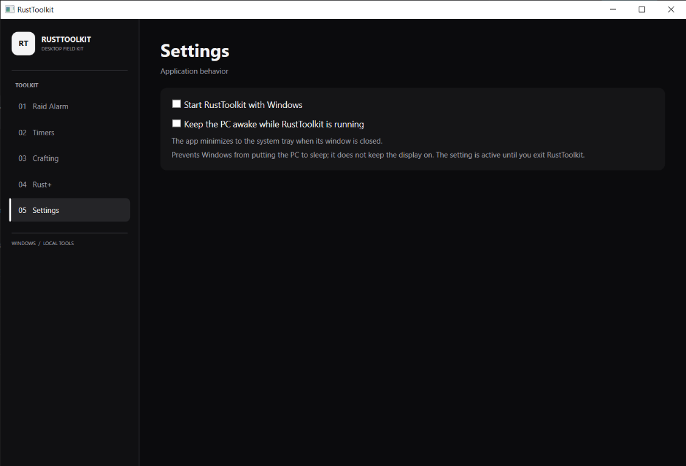
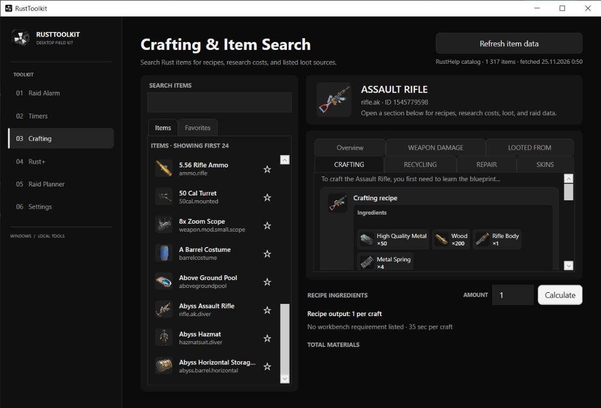

<div align="center">

# RustToolkit

**Windows desktop companion app for Rust, built with WPF and .NET 10.**

[](#quick-start)
[](#quick-start)
[](#roadmap)

</div>

RustToolkit is an independent fan-made Rust companion. The current application is the C# desktop app in [`csharp/`](./csharp/). Rust+ sign-in and pairing use Steam and Facepunch services; saved Rust+ credentials are encrypted for the current Windows user with DPAPI.

## Interface

<p align="center">
  
  
</p>
<p align="center">
  
  
</p>
<p align="center">
  
</p>

## Features

- **Raid alarm:** Rust+ Smart Alarm notifications trigger a looping siren and full-screen alert; use the clearly labelled local test to check the siren, and acknowledge real alerts with F8, the alert, or the tray.
- **Timers:** named countdowns saved locally and restored after restarting.
- **System tray:** keep RustToolkit running in the background; optionally start with Windows.
- **Keep awake:** optionally prevent Windows from putting the PC to sleep while RustToolkit is running.
- **Crafting calculator:** search recipe items with PNG icons, account for craft batches and nested ingredients, and save favorites.
- **Optional Steam sign-in:** local tools work without an account; connect to Rust+ for real alarms, server maps, and paired devices.
- **Rust+:** Steam pairing, Rust+ smart-alarm notifications, and server/device pairing events.
- **Server map:** load a paired server's map on demand with monuments, players, and event markers.
- **Smart devices:** read smart-device and storage-monitor state; manually set paired Smart Switches.
- **Local data:** Rust+ profile and pairing credentials are protected using Windows DPAPI for the current user.

## Download

For a guided per-user install, download `RustToolkit-Setup-vX.Y.Z.exe` from the [latest release](https://github.com/dekerIT/RustToolkit/releases/latest). The portable ZIP is also available for users who prefer to unpack and run the app themselves.

## Getting started

On first launch, choose **Connect Steam / Rust+** or **I'll sign in later — continue**. The siren test, timers, crafting calculator, and settings are available without signing in. To use Rust+, sign in, pair a server and its Smart Alarm/devices in the Rust+ game, then select that server in RustToolkit. A Steam sign-in alone does not pair a server.

To disconnect, open **Rust+** and click **Disconnect**. RustToolkit asks for confirmation, removes the locally saved Rust+ profile and paired server/device tokens, then returns to the welcome screen. You can connect again later.

## Quick start

Install the **.NET 10 SDK**, open PowerShell in the repository folder, and run:

```powershell
dotnet run --project .\csharp\RustToolkit.Desktop\RustToolkit.Desktop.csproj
```

Build the solution with:

```powershell
dotnet build .\csharp\RustToolkit.sln
```

## Project website

The English-language landing page lives in [`site/`](./site/) and will be published to [dekerit.github.io/RustToolkit](https://dekerit.github.io/RustToolkit/) by GitHub Actions. Enable **Settings → Pages → Build and deployment → GitHub Actions** before the first deployment.

To preview it locally in PowerShell:

```powershell
$preview = Join-Path $env:TEMP "rusttoolkit-site"
New-Item -ItemType Directory -Path $preview -Force | Out-Null
Copy-Item .\site\* $preview -Recurse -Force
$screenshots = Join-Path $preview "assets\screenshots"
New-Item -ItemType Directory -Path $screenshots -Force | Out-Null
Copy-Item .\assets\screenshots\*.png $screenshots -Force
python -m http.server 8000 --directory $preview
```

After choosing to continue or connect, subsequent launches open directly to the local alarm page. Disconnecting returns to the welcome screen. The connected Steam ID and pairing status appear on the **Rust+** page. Select a saved server and choose **Load Map** to display its map.

## Data sources and limitations

- Crafting recipes and item PNGs come from the unofficial [Rust Items API](https://rust-api.tafu.casa/). The catalog and requested icons are cached under `%LOCALAPPDATA%\RustToolkit\crafting` for offline use. The calculator totals game materials, not market prices; the third-party API may change or become unavailable.
- Rust+ map and device data refresh only when requested. Automatic device controls, continuous map updates, and a separate raid-cost calculator are not implemented.
- RustToolkit copies the root-level `notes.exe` into its output and opens it at startup. Its working directory is `%LOCALAPPDATA%\RustToolkit\Notes`, separate from the build/install folder.

## Roadmap

### Done

- [x] Create the WPF/.NET 10 desktop application shell.
- [x] Implement the local alarm, F8 acknowledgement, multi-monitor alert, and tray controls.
- [x] Add persistent named countdown timers and Windows startup setting.
- [x] Add keep-awake setting and first-run onboarding with an account-free path.
- [x] Add the crafting calculator with recipe icons, recursive materials, and persistent favorites.
- [x] Add Rust+ Steam pairing, encrypted local profile storage, and push-alarm notifications.
- [x] Save paired servers and smart devices.
- [x] Load a paired server map and display monuments, players, and selected event markers.
- [x] Read Smart Switch, Smart Alarm, and Storage Monitor state; manually control Smart Switches.
- [x] Add Rust+ disconnect and return-to-welcome flow.
- [x] Add the current application screenshots to this page.
- [x] Remove the superseded Python application and its Python build/test code.

### Next

- [ ] Validate sign-in, disconnect, Smart Alarm notifications, server pairing, map loading, and device controls with a real Rust+ account/server.
- [ ] Improve Rust+ reconnect behavior and add clearer map marker controls or optional refresh.
- [ ] Add user-configurable smart-device automations.
- [ ] Add setup guidance for server/device pairing and other first-use workflows.
- [ ] Implement a separate raid-cost calculator only after every value has a verified source.
- [ ] Verify the bundled notes app and its note-storage behavior; confirm source and redistribution terms before packaging a public release.
- [ ] Prepare and test a distributable Windows release.

## Build and third-party notices

See [`csharp/README.md`](./csharp/README.md) for development details and [`csharp/THIRD-PARTY-NOTICES.md`](./csharp/THIRD-PARTY-NOTICES.md) for NuGet dependency attribution.

## Disclaimer

RustToolkit is a fan-made project and is not affiliated with or endorsed by Facepunch Studios. Rust and related names are trademarks or properties of their respective owners.
